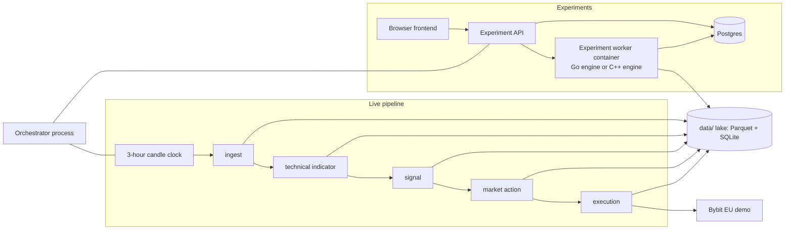

# Dagobert

Dagobert is a personal suite for systematic crypto spot swing trading on 3-hour UTC candles. It loads public Binance klines, computes indicators, runs rule-based playbooks, and places paper orders on the Bybit EU demo. The same playbook code runs in live paper trading and in backtests. See [docs/IDEA.md](docs/IDEA.md) for the idea behind it.

There are two ways to use it:

- **Live pipeline.** Every time a 3-hour candle closes, the orchestrator runs five stateless containers in order. Each prints `DETAIL=<n>` and exits `0` (succeeded), `1` (failed, retried) or `2` (already stored, nothing to do).
- **Experiments.** In the web UI you define an experiment: a date range, costs, and many strategy instances (set by hand or as a parameter grid). A worker container simulates them all and stores the results.

## Architecture



- The Experiment API runs inside the orchestrator process. It is only mounted when `DATABASE_URL` is set, so it needs Postgres. Compose sets this for you.
- The worker is the `dagobert-backtest` image. `EXPERIMENT_ENGINE=go` is the default. `cpp` is opt-in and supports `ma-cross` and `signal-consensus` only.
- The live pipeline always uses the Go jobs.
- The frontend talks only to the Experiment API. It does not read `data/`.

The five jobs are: ingest, calculation-technical-indicator, calculation-signal, calculation-market-action, execution. Only execution holds Bybit credentials.

## Quickstart

You need Docker and [Devbox](https://www.jetify.com/devbox). The [Atlas](https://atlasgo.io) CLI is also needed for `task db:migrate` (it is not in the devbox shell).

```bash
devbox shell
task build        # job images and compose images, once
task up           # Floci, Postgres, orchestrator, frontend
task db:migrate   # create the Postgres schema (first start, and after new migrations)
```

Nothing applies the migrations automatically, so run `task db:migrate` once the stack is up. Then open [http://localhost:11001](http://localhost:11001). Change the port with `WEB_PORT` in `.env` (see `env.example` for the other ports).

`task up` merges `compose.override.yaml`, so it serves the Vite dev server with `src/frontend` mounted. `task dev` is the same plus `compose watch`. `task up:prod` skips the override and serves the production frontend image.

**Run an experiment.** Create one in the UI and start it there. The orchestrator launches the worker container. To run one by hand: `EXPERIMENT_ID=<uuid> task experiment-run`. To fill `data/` with a year of BTC demo data and a simulated pipeline run (wipes `data/`, no Bybit): `task seed-demo-year`.

**Run the live pipeline.** The orchestrator starts it by itself at each 3-hour boundary. To start one execution now: `task run` (`CANDLE_CLOSE_MS` defaults to `1700006400000`). A repeat of the same close does not place a second order. Execution needs a Bybit demo key in a gitignored `.secrets` file. See [docs/execution/bybit-eu-demo.md](docs/execution/bybit-eu-demo.md) for how to get a key.

```bash
BYBIT_API_KEY=...
BYBIT_API_SECRET=...
```

## Tasks

Run `task --list` for all of them.

| Task | What it does |
| --- | --- |
| `task build` | Build the job images and the compose images. |
| `task up` | Start the stack with the dev frontend. Runs `docker compose up`. |
| `task dev` | Same as `up`, with compose watch. |
| `task up:prod` | Start the stack without the override (production frontend). |
| `task up:build` | Build everything, then start the stack. |
| `task down` | Stop the stack. `./data` is kept. |
| `task run` | One live-pipeline execution for `CANDLE_CLOSE_MS`. |
| `task experiment-run` | Run one experiment by `EXPERIMENT_ID` in the backtest image. |
| `task seed-demo-year` | Wipe `data/`, backfill 1 year of BTC, run `ma-cross` with a simulated venue. |
| `task test` | System tests for the job images. |
| `task cpp:deps`, `cpp:build`, `cpp:test`, `cpp:bench` | C++ engine: build dependencies once (`PRESET=debug` or `optimized`), build, test, benchmark against Go. |
| `task db:up`, `db:migrate`, `db:diff name=...`, `db:sqlc` | Postgres: start it, apply Atlas migrations, generate a migration, regenerate sqlc code. |
| `task proto:lint`, `proto:gen`, `proto:breaking` | Protobuf checks and code generation. |
| `task data:migrate-candles` | Rewrite old string candle files to the decimal schema. |

## Tests

```bash
task test                                                          # system tests, about 20 minutes
go test ./tests/system/ingest -run TestName -count=1 -timeout 20m  # one system test (image built first)
go test ./src/internal/... ./src/shared/...                        # unit tests
task cpp:test                                                      # C++ tests
cd src/frontend && npm run build                                   # frontend typecheck
```

System tests build each job image and run it against a faked upstream. There is no browser test suite.

## Where to start

- [docs/README.md](docs/README.md): index of all docs.
- [docs/STATUS.md](docs/STATUS.md): what is done and what is next.
- [docs/glossary.md](docs/glossary.md): terms such as experiment, instance, playbook.
- [docs/architecture/experiment-data-flow.md](docs/architecture/experiment-data-flow.md): how an experiment runs.
- [docs/architecture/pipeline-data-flow.md](docs/architecture/pipeline-data-flow.md): how a candle moves through the five jobs.
- [docs/development/](docs/development/README.md): workflow, issues, agent harness.
