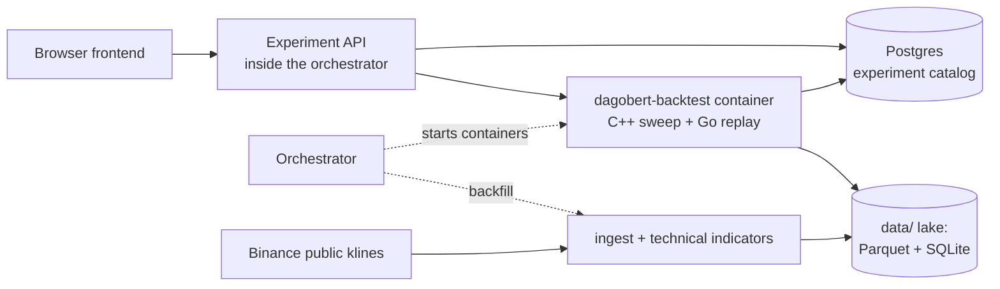

# Dagobert

Dagobert is a backtesting framework for systematic crypto spot swing trading on 3-hour UTC candles. It loads public Binance klines, computes indicators, runs rule-based strategies ("playbooks") over history, and simulates the orders with trading costs. You define an experiment in a web UI (a date range, costs, and many strategy instances, by hand or as a parameter grid) and compare the results by KPI. No exchange account or API key is needed, and no order ever leaves your machine. See [docs/IDEA.md](docs/IDEA.md) for the idea behind it.

## Features

- **Experiments.** One date range, capital and cost model, shared by many instances. Instances are listed by hand or expanded from a parameter grid (up to 20,000). Progress, fills, equity curves and KPIs are stored and shown in the UI.
- **Playbooks.** `ma-cross` (moving-average crossover) and `signal-consensus` (several indicator signals voted into buy, hold or sell), with optional stop-based position sizing (unit risk, heat, max units). See [src/calculation-signal/playbooks](src/calculation-signal/playbooks).
- **Indicators.** ATR, close-distance, EMA, SMA, MACD, RSI and volume-mean, each documented in its own README under [src/calculation-technical-indicator/internal/indicators](src/calculation-technical-indicator/internal/indicators).
- **KPIs.** Active return, CAGR, max drawdown, Sharpe, Sortino and win rate, compared with buy-and-hold over the same range.
- **Cost model.** Spread, slippage and fee in basis points against the bar close ([docs/architecture/backtesting.md](docs/architecture/backtesting.md)).
- **C++ engine.** Experiments run on the C++ sweep (`ma-cross` and `signal-consensus`; other playbooks fail the experiment). Go replays the sweep's actions into fills and reports with the same fill model. Each experiment sets its own "Parallel processes" (auto = one per CPU). Benchmarks: [docs/development/05-cpp-benchmark.md](docs/development/05-cpp-benchmark.md).
- **Data lake.** Binance klines as Hive-partitioned Parquet with decimal prices. Missing exchange hours are recorded as `unavailable`, never invented. Missing history is fetched automatically when an experiment starts.
- **Wiki.** The UI renders the indicator, playbook and KPI docs, so the docs in the repo are the docs in the app.

## Quickstart

You need Docker and [Devbox](https://www.jetify.com/devbox). The [Atlas](https://atlasgo.io) CLI is also needed for the migration step (it is not in the devbox shell).

```bash
devbox shell
task dev          # builds the images (the first build compiles the C++ engine and is the slow step), applies Terraform on Floci (Aurora, S3, the ECS frontend), migrates Postgres, starts the stack
```

Open [http://localhost:11001](http://localhost:11001), create an experiment and start it. The first run downloads the candles it needs from Binance. Change the port with `WEB_PORT` in `.env` (see `env.example` for the others).

- `task seed-demo-year` fills `data/` with one year of BTC and replays `ma-cross` over it. It wipes `data/`.
- `task up` skips the image builds. Frontend with hot reload: `task frontend:dev` (host, port 3000). `task down` stops the stack and keeps `./data`.
- `EXPERIMENT_ID=<uuid> task experiment-run` runs an existing experiment from the command line.

## How it works



- The orchestrator hosts the Experiment API (needs `DATABASE_URL`, which compose sets) and starts job containers through the Docker socket. A job exits `0` (succeeded), `1` (failed) or `2` (already stored, nothing to do) and logs `DETAIL=<n>`.
- An experiment run has three phases: prepare (check data, build indicators), simulate (run the instances, optionally in batches) and finalize (write KPIs).
- The frontend talks only to the Experiment API and never reads `data/`.

## Repository layout

| Path | What is there |
| --- | --- |
| `src/frontend` | Vite + React app: Experiments, Connectors, Wiki. |
| `src/orchestrator`, `src/experimentapi` | Orchestrator process and the Connect-RPC Experiment API (`ExperimentService`). |
| `src/backtest`, `src/cmd/backtest` | Experiment engine and the `dagobert-backtest` entrypoint. |
| `src/calculation-signal` | Playbooks, the replay framework, sizing and strategy KPIs. |
| `src/calculation-technical-indicator` | One package per indicator. |
| `src/calculation-market-action`, `src/execution`, `src/internal/venue` | Sizing, simulated fills and the paper wallet used by every run. |
| `src/ingest` | Binance klines into the Parquet lake. |
| `src/calculation` | C++ engine (`ma-cross`, `signal-consensus`). |
| `db`, `proto`, `infra` | Postgres schema (Atlas, sqlc), protobuf contracts, Terraform for Floci and AWS (VPC, Aurora, S3, SSM, IAM). |
| `tests/system` | System tests: build a job image, run it against faked upstreams, check the output. |
| `docs` | Architecture, contracts, status and workflow. Index: [docs/README.md](docs/README.md). |

## Tasks

Run `task --list` for all of them.

| Task | What it does |
| --- | --- |
| `task build` | Build the job images and the compose images. |
| `task up` | Apply Terraform on Floci (Aurora, S3, the frontend on ECS), migrate, then `docker compose up` (Floci and the orchestrator). |
| `task dev` | Build the job and compose images, then `task up`. |
| `task frontend:dev` | Vite dev server with hot reload on the host, proxying `/api` to the orchestrator. |
| `task up:build` | Build everything, then start the stack. |
| `task down` | Stop the stack. `./data` is kept. |
| `task experiment-run` | Run one experiment by `EXPERIMENT_ID` in the backtest image. |
| `task seed-demo-year` | Wipe `data/`, backfill 1 year of BTC, replay `ma-cross`. |
| `task test` | System tests for the job images. |
| `task cpp:deps`, `cpp:build`, `cpp:test` | C++ engine: build dependencies once (`PRESET=debug` or `optimized`), build, test. The experiment benchmark is `TestBenchPersistGrid`, see `docs/development/05-cpp-benchmark.md`. |
| `task db:up`, `db:migrate`, `db:diff name=...`, `db:sqlc` | Postgres: start it, apply Atlas migrations, generate a migration, regenerate sqlc code. |
| `task proto:lint`, `proto:gen`, `proto:breaking` | Protobuf checks and code generation. |
| `task data:migrate-candles` | Rewrite old string candle files to the decimal schema. |

## Tests

```bash
task test                                                          # system tests, takes a while (CI runs everything on each PR and each merge to main)
go test ./tests/system/ingest -run TestName -count=1 -timeout 20m  # one system test (image built first)
go test ./src/internal/... ./src/shared/...                        # unit tests
task cpp:test                                                      # C++ tests
cd src/frontend && npx tsc --noEmit && npm run build                # frontend typecheck and build
```

There is no browser test suite.

## Where to go next

- [docs/README.md](docs/README.md): index of all docs.
- [docs/STATUS.md](docs/STATUS.md): what is done and what is next.
- [docs/glossary.md](docs/glossary.md): terms such as experiment, instance, playbook.
- [docs/architecture/experiment-data-flow.md](docs/architecture/experiment-data-flow.md): how an experiment runs, end to end.
- [docs/architecture/backtesting.md](docs/architecture/backtesting.md): engines, phases, cost model.
- [docs/development/](docs/development/README.md): workflow, issues, agent harness.
