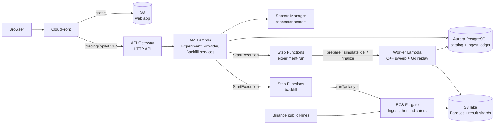

# Dagobert

A backtesting platform for systematic crypto spot swing trading on 3-hour UTC candles, built as a serverless AWS system that runs unchanged on a laptop.

You define an experiment in a web UI (date range, costs, and up to 20,000 strategy instances, by hand or as a parameter grid). The platform fetches public Binance klines, computes indicators, simulates every instance with trading costs and ranks the results by KPI. There is no exchange account, no API key and no live trading; fills are simulated. The idea behind it: [docs/IDEA.md](docs/IDEA.md).

## Highlights

- **Serverless on AWS, one Terraform for local and prod.** API Gateway, Lambda, Step Functions, ECS Fargate, Aurora PostgreSQL Serverless v2, S3, CloudFront, SSM and Secrets Manager. Locally the same Terraform runs against Floci, an AWS emulator, so the local stack exercises the real infrastructure code and not a mock.
- **Data lake on S3.** Hive-partitioned Parquet with fixed-scale decimal prices. Missing exchange hours are recorded as `unavailable`, never invented.
- **Fan-out with Step Functions.** An experiment run is a state machine (prepare, a Map over instance batches, finalize) that calls one worker Lambda; a backfill is a second state machine over ECS tasks.
- **Mixed-language compute.** A C++ engine sweeps the parameter grid in parallel; Go replays its actions into fills and reports with the same fill model the rest of the system uses.
- **Typed contracts.** Connect-RPC over protobuf (buf lint and breaking checks in CI), Postgres schema as code (Atlas, sqlc), generated Go and TypeScript clients.
- **Tests that prove behaviour.** System tests build each real job image and run it against faked upstreams; CI also type-checks the frontend and validates the Terraform.

## Architecture



| Concern | Choice | Why |
| --- | --- | --- |
| API | One Lambda behind an API Gateway HTTP API serving three Connect-RPC services | Stateless, scales to zero, one deployable. Unary RPC maps cleanly onto Lambda's request/response model. |
| Long-running work | Step Functions orchestrating a worker Lambda (experiments) and ECS Fargate tasks (backfills) | Runs outlive an HTTP request and need retries, cancellation and progress. Short, parallel simulation fits Lambda; the long, I/O-heavy download fits a container with no 15-minute limit. |
| Fan-out | Prepare, then a Map over instance batches, then finalize | Instance counts reach 20,000. Batching bounds per-invocation time and gives natural retry units. |
| Bulk data | Parquet on S3 (candles, indicator bars, per-instance result shards) | Append-mostly, columnar, cheap, read whole by one worker. No database holds row-heavy data. |
| Control plane | Aurora PostgreSQL | Experiments, instances, status and the ingest ledger need transactions and queries. Row-heavy results stay out of it. |
| Idempotency | Job exit codes `0` ok, `1` failed, `2` already stored; every job no-ops on stored work | Safe retries and re-runs. Cancellation is guarded in SQL (`status <> 'cancelled'`) so a late worker cannot revive a cancelled run. |
| Secrets | Secrets Manager at `/<project>/<env>/providers/<id>`; database URL in SSM SecureString | Secrets never live in the repo or the database. |
| Web app | Private S3 bucket behind CloudFront, API on the same origin | No public container and no CORS. CloudFront is the only public entry point. |
| Local parity | Same Terraform, `environment=local` or `prod` | Differences are limited to endpoints, credentials and a few sizing flags. |

Deeper reading: [docs/architecture/local-stack.md](docs/architecture/local-stack.md) (what runs where), [experiment-data-flow.md](docs/architecture/experiment-data-flow.md) (an experiment end to end), [backtesting.md](docs/architecture/backtesting.md) (engine, phases, cost model).

## Quickstart (local)

You need Docker and [Devbox](https://www.jetify.com/devbox). The [Atlas](https://atlasgo.io) CLI must also be on your `PATH` for the migration step (it is not in the devbox shell).

```bash
devbox shell
task up           # Floci, Terraform apply, image builds, web app upload, DB migrations; prints the web app URL
```

`task up` provisions the whole stack on Floci and ends by printing the URL of the compiled web app, for example `http://<id>.cloudfront.localhost:11566/`. Open it, create an experiment and start it. The first run downloads the candles it needs from Binance. The first `task up` is slow because it builds the images.

For UI development use `task dev`: it runs `task up`, then Vite with hot reload at [http://localhost:3000](http://localhost:3000), proxying the API to the local gateway. Ctrl-C stops Vite and leaves Floci running.

| Port | What |
| --- | --- |
| 11566 | Floci (every AWS endpoint, the API gateway and CloudFront) |
| 7001 | Aurora PostgreSQL (Floci proxy) |
| 3000 | Vite dev server (`task dev` only) |

Good to know:

- **Deep links.** Floci does not run CloudFront Functions, so the compiled site serves the start page and assets but 404s on deep links. Use `task dev` for those.
- **Recreating Floci** (for example after changing `compose.yaml`) wipes all emulated resources. Run `task up` again. If Terraform then fails with "couldn't find resource", move `infra/terraform/terraform.tfstate*` aside first.
- **Idle Lambda containers** are reaped after 60 s (`LAMBDA_IDLE_TIMEOUT_SECONDS`), so `docker ps` stays tidy; the next call is a cold start.
- `task down` stops Floci and keeps `./data`. `task seed-demo-year` wipes `data/`, backfills one year of BTC and replays `ma-cross` over it.

## Production

`task infra:prod` applies the same Terraform to real AWS and refuses to run outside CI with credentials. Prod adds interface VPC endpoints and an `allow_cloud_deploy` gate. Known gaps before a real deployment, tracked rather than hidden:

- No deploy workflow yet (OIDC role assumption and a pipeline that calls `scripts/infra-apply.sh prod`).
- Terraform state is local; a remote backend (S3 with locking) is not configured.
- The database URL reaches the Lambda as an environment variable; it should be read from SSM at start-up.
- CloudFront Origin Access Control (private bucket) is used in prod only; Floci does not enforce it, so that path is not exercised locally.

## Features

- **Experiments.** One date range, capital and cost model for many instances. Progress, fills, equity curves and KPIs are stored and shown in the UI.
- **Playbooks.** `ma-cross` (moving-average crossover) and `signal-consensus` (several indicator signals voted into buy, hold or sell), with optional stop-based position sizing. See [src/calculation-signal/playbooks](src/calculation-signal/playbooks).
- **Indicators.** ATR, close-distance, EMA, SMA, MACD, RSI and volume-mean, each documented in its own README under [src/calculation-technical-indicator/internal/indicators](src/calculation-technical-indicator/internal/indicators).
- **KPIs.** Active return, CAGR, max drawdown, Sharpe, Sortino and win rate, against buy-and-hold over the same range.
- **Cost model.** Spread, slippage and fee in basis points against the bar close.
- **C++ engine.** Per-experiment "Parallel processes" (auto = one per CPU). Benchmarks: [docs/development/05-cpp-benchmark.md](docs/development/05-cpp-benchmark.md).
- **Wiki.** The UI renders the indicator, playbook and KPI docs, so the docs in the repo are the docs in the app.

## Repository layout

| Path | What is there |
| --- | --- |
| `infra/terraform` | VPC, Aurora, S3, CloudFront, API Gateway, Lambdas, Step Functions, ECS, IAM, SSM, Secrets Manager. |
| `src/experimentapi`, `src/cmd/experiment-api-lambda` | The Connect-RPC services and the Lambda that serves them. |
| `src/cmd/experiment-worker`, `src/internal/experimentworkflow` | Worker Lambda: prepare, simulate, finalize. |
| `src/backtest`, `src/calculation` | Experiment engine (Go) and the C++ sweep. |
| `src/calculation-signal`, `src/calculation-technical-indicator` | Playbooks, replay framework, strategy KPIs; one package per indicator. |
| `src/ingest` | Binance klines into the Parquet lake. |
| `src/frontend` | Vite + React + TypeScript app: Experiments, Connectors, Wiki. |
| `db`, `proto` | Postgres schema (Atlas, sqlc) and protobuf contracts. |
| `tests/system` | Build a job image, run it against faked upstreams, check the output. |
| `docs` | Architecture, contracts, status and workflow. Index: [docs/README.md](docs/README.md). |

## Common tasks

Run `task --list` for all of them.

| Task | What it does |
| --- | --- |
| `task up` / `task down` | Start the full stack on Floci / stop it (keeps `./data`). |
| `task dev` | `task up`, then the web app with hot reload on :3000. |
| `task build` | Build the job images. |
| `task test` | System tests for the job images. |
| `task db:diff name=...`, `db:migrate`, `db:sqlc` | Postgres: generate a migration, apply it, regenerate sqlc code. |
| `task proto:lint`, `proto:gen`, `proto:breaking` | Protobuf checks and code generation. |
| `task cpp:deps`, `cpp:build`, `cpp:test` | C++ engine: build dependencies once (`PRESET=debug` or `optimized`), build, test. |
| `task infra:local` / `task infra:prod` | Terraform against Floci / real AWS (prod: CI only). |

## Tests

```bash
task test                                                          # system tests (CI runs everything on each PR, each merge to main and nightly)
go test ./tests/system/ingest -run TestName -count=1 -timeout 20m  # one system test (image built first)
go test ./src/internal/... ./src/shared/...                        # unit tests
task cpp:test                                                      # C++ tests
cd src/frontend && npx tsc --noEmit && npm run build                # frontend typecheck and build
```

System tests are the proof of behaviour; unit tests cover pure logic only. There is no browser test suite, and no CI job yet that provisions the Floci stack and tests against it.

## Where to go next

- [docs/README.md](docs/README.md): index of all docs. [docs/STATUS.md](docs/STATUS.md): what is done and what is next.
- [docs/glossary.md](docs/glossary.md): experiment, instance, playbook.
- [docs/development/](docs/development/README.md): workflow, issues, agent harness.
