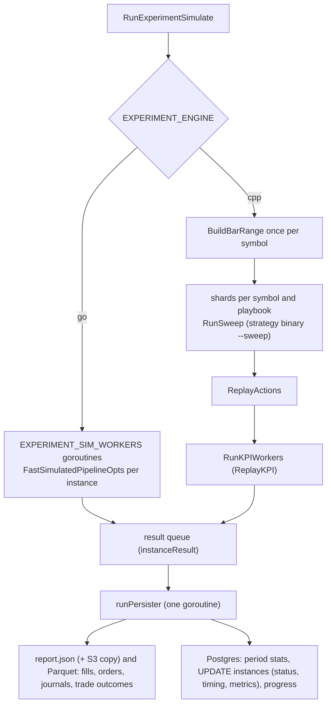
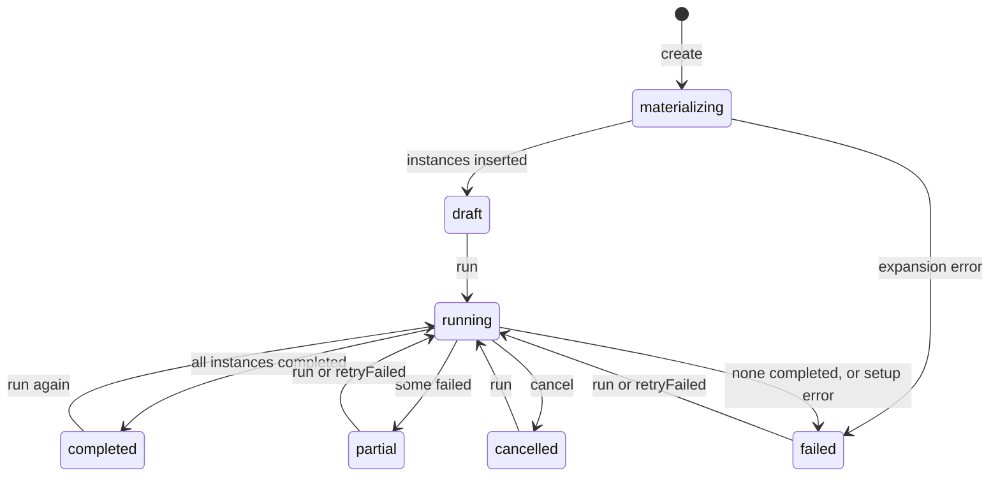
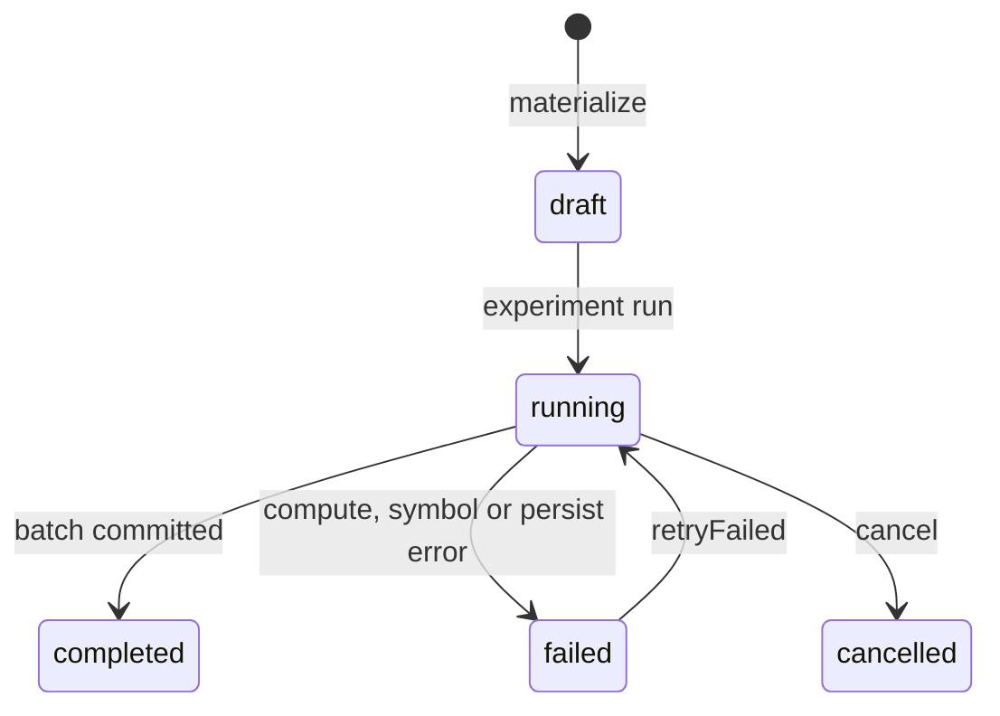

# Experiment and instance data flow

How an experiment goes from a click in the browser to fills, reports and rows in the database. Settings and tolerances are in [backtesting.md](backtesting.md); the live per-candle pipeline is in [pipeline-data-flow.md](pipeline-data-flow.md).

- **Experiment**: one row with shared settings (range, capital, costs, provider) and N instances.
- **Instance**: one strategy config (playbook + `strategyConfig`) on one symbol. Its workspace is `data/experiments/<experiment_id>/instances/<instance_id>/` (`store.ExperimentWorkspaceDir`): `report.json` and the Parquet files `fills.parquet`, `orders.parquet`, `journals.parquet`, `trade_outcomes.parquet` (`src/internal/instanceparquet`).

## The picture

```mermaid
sequenceDiagram
    participant B as Browser
    participant A as Experiment API (inside orchestrator)
    participant P as Postgres catalog
    participant O as Orchestrator fan-out
    participant W as dagobert-backtest container
    participant L as Lake and workspaces
    B->>A: POST /api/v1/experiments
    A->>P: insert experiment (materializing), instances (draft)
    A->>P: status draft
    B->>A: POST /api/v1/experiments/{id}/run
    A->>P: experiment and instances running
    A->>O: hook RunExperiment (202)
    O->>W: prepare
    W->>L: coverage, ingest gaps, indicator window, KPI handoff files
    O->>W: simulate (one or many batches)
    W->>P: batched period stats and UPDATE per instance
    W->>L: report.json and Parquet files per instance
    O->>W: finalize
    W->>L: read trade_outcomes.parquet per instance
    W->>P: performance, final status, drop the prepare cache
    loop every 1500 ms
        B->>A: GET /experiments/{id}/progress
        A->>P: read row
    end
```

The simulate phase, per instance:

## Lifecycle

Statuses are the strings in `src/backtest/store/store.go` and the SQL in `db/sqlc/queries/`.

Rules: `POST .../run` returns 409 while the experiment is `running`. `retryFailed` returns 400 when no instance failed, and re-simulates only `failed` instances (`EXPERIMENT_RETRY_FAILED=1` in the worker). An instance is `completed` only after its persistence batch committed.

## Stages

| Stage | Entry point | Inputs | Outputs / state | Failure and retry |
|---|---|---|---|---|
| Create | `handleCreateStudy` -> `createStudy` (`src/experimentapi/create.go`) | settings + MANUAL list or GRID axes (`specsFromGrid`, max 20 000 valid combos) | `experiment` row `materializing`, then `experiment_instance` rows, status `draft` | up to 250 instances (`syncMaterialize`) in the request, more via `materializeAsync`; error -> experiment `failed` |
| Run request | `handleRunExperiment` (`handlers.go`) | experiment id, `retryFailed` | experiment and instances `running`; hook `RunExperiment` | 409 if running; orchestrator ignores the hook call if another job runs (single-flight) |
| Fan-out | `runStudyJob` (`src/orchestrator/cmd/orchestrator/experiment_fanout.go`) | `EXPERIMENT_RUN_BACKEND` | worker containers with `EXPERIMENT_PHASE` | any non-zero exit stops the job; job state is in memory only |
| Prepare | `RunExperimentPrepare` (`src/backtest/run_experiment_phases.go`) | settings, Parquet lake, `ingest.sqlite` | progress stages 1-3; workspaces, paper wallet; KPI handoff files (`WriteAllExperimentSymKPI`, `WriteExperimentPrepareMeta`) | symbol without coverage: `ingestExperimentRange` then re-check; still failing -> `failSymbol` fails its instances; unavailable hours do not block |
| Simulate | `RunExperimentSimulate` | handoff files, instance ids | progress stage 4; instance results to the persister | per-instance error -> `failed` row; function only errors on setup |
| Persist | `runPersister` (`persist_pipeline.go`) | `instanceResult` queue | `report.json` and Parquet files per instance; Postgres period stats, status, timing, metrics | Parquet write error fails the instance (its files are removed); batch retried 3x (backoff), then bisected to single instances; last resort `failed` with `persist: ...` |
| Finalize | `RunExperimentFinalize` | instance statuses, `trade_outcomes.parquet` | `experiment_performance` (Postgres), final status, then the prepare cache (`.cache`) is removed | zero completed -> `failed`; any failed -> `partial`; else `completed`. Re-finalizing a finished experiment is not supported (the cache is gone); a new run re-prepares it |

The catalog is Postgres. The worker needs `DATABASE_URL` (`pgcatalog.Open`); without it the run fails (`experiment_catalog.go`).

Where state lives:

| State | Location |
|---|---|
| Experiment, instances, metrics, period stats, performance | Postgres (`db/sqlc/schema.sql`: `experiment`, `experiment_instance`, `experiment_instance_period_stat`, `experiment_performance`, `experiment_period_stat`, `experiment_outcome_stat`) |
| Candles | `data/parquet/provider=.../` (read-only here), gaps in `ingest.sqlite` `unavailable` |
| Indicator window per symbol | `data/experiments/<experiment_id>/.cache` (handoff files from prepare to simulate and finalize), removed at the end of finalize |
| Per instance | `data/experiments/<experiment_id>/instances/<instance_id>/`: paper wallet, `report.json`, `fills.parquet`, `orders.parquet`, `journals.parquet`, `trade_outcomes.parquet` |
| Running job (id, error, finished) | orchestrator memory (`experimentJob`) |

Production `technical_indicator.sqlite` is never written by an experiment.

## One instance in detail

Both paths share: the playbook config is resolved and validated per slug, the run uses `VENUE_SIMULATE=1`, sizing comes from `allocate.PolicyFromEnv()` (`ALLOC_*`, copied from the experiment settings by `applyExperimentEnv`), and the fill model is `execrunner.SimulateBarWithModel` (`src/internal/venue/sim`: spread, slippage and fee in bps against the bar close).

### Go path

1. `FastSimulatedPipelineOpts(ws, win, playbook, sym, closes, opts)` (`src/calculation-signal/runner/fast_pipeline.go`) with `Slim`, `SkipSampler` and `Capture`: no signal or action SQLite rows, no execution SQLite and no wallet write.
2. Per bar of the shared `kpi.Window`: `Strategy.Evaluate(framework.Context)`, sizing (`sizing.Unit`, planned size), then `SimulateBarWithModel` updates the wallet and the captured orders and journals (`execrunner.Activity`).
3. `FillsFromActivity` derives the fills from the captured journals; `BuildInstanceReport` (`runner/instance_report.go`) builds KPIs, monthly and yearly stats and series in memory.
4. The result goes to the queue; the persister writes `report.json` and the Parquet files.

### C++ path

1. `BuildBarRange` (`src/calculation-technical-indicator/runner/bar_range.go`) once per symbol: aggregated bars, sub-candle closes, warm-up bars.
2. `cppSimulate` (`src/backtest/cpp_engine.go`) groups instances by symbol and playbook, cuts shards (see knobs), and per shard `BuildSweepRequest` then `RunSweep` runs `strategy-sma-cross` or `strategy-signal-consensus` with `--sweep` (protobuf `SweepRequest` in, run report out, `src/backtest/cpp_sweep.go`).
3. `ReplayActions` turns the reported sized actions into `ReplayAction`s; `RunKPIWorkers` -> `ReplayKPI` (`kpi_worker.go`) replays them against bar closes with the same `SimulateBarWithModel`, rescales sizes by replayed wallet equity over the C++ book equity, and builds the report with `BuildInstanceReportFromSim`. No disk or database access.
4. Same queue and persister as the Go path.

`ReplayKPI` returns the same orders and journals as the Go path (`KPIResult.Orders`, `KPIResult.Journals`), so both engines write identical instance files. No per-instance fallback to Go: an unsupported playbook or missing binary fails the instance; a crashed shard fails all its instances.

### Where the two paths must agree

The Go path cannot trade on its first evaluated bar, so the C++ `trade_from_ms` is one bar later. `TestSmaCrossGoVsCppEquivalence` and `TestConsensusGoVsCppEquivalence` (`src/backtest/cpp_sweep_test.go`) compare fills (timestamp and side exact, quantity and price within 1e-9) and KPIs (within 1e-6). Details in [backtesting.md](backtesting.md).

## Progress and what the frontend polls

Base URL `VITE_EXPERIMENT_API_URL` (dev proxy in `src/frontend/vite.config.ts`). Routes: `src/experimentapi/api.go`.

| Endpoint | Shows | Used by |
|---|---|---|
| `GET /api/v1/experiments` | experiment list | list view |
| `GET /api/v1/experiments/{id}` | summary only | detail header |
| `GET .../{id}/progress` | status, stage (1 prepare, 2 market data, 3 indicators, 4 instance simulation), instance done/total, failed count | polled every 1500 ms while selected (`components/experiments-panel.tsx`), then the instance page reloads |
| `GET .../{id}/instances` | paginated, SQL sort and filter on metric columns | instance table |
| `GET .../instances/{instanceId}` | one instance row | detail |
| `.../report`, `.../kpis`, `.../activity`, `.../chart-series?from=&to=[&maxPoints=N]` (unix s) | report, win-rate ladders, fills, chart data | instance detail |

Every response is gzip-coded when the client asks for it (`Accept-Encoding: gzip`). `maxPoints` on `chart-series` buckets the candles to at most N (OHLC aggregated, indicators at the bucket's last candle); portfolio and markers stay exact. The frontend sends about two candles per viewport pixel (400 to 4000), and each zoom or range preset fetches its window with the same budget. See `src/experimentapi/README.md`.
| `GET .../{id}/performance` | experiment-level reduction | performance view |
| `GET .../{id}/status` | aggregate status (`status.go`) | not used by `api.ts` |
| `POST .../{id}/run`, `POST .../{id}/cancel`, `DELETE .../{id}` | actions | buttons |

## Knobs

| Variable | Default | Meaning |
|---|---|---|
| `DATABASE_URL` | unset | Postgres catalog, required by the worker (a run fails without it) and by the Experiment API (routes are mounted only when set) |
| `EXPERIMENT_ENGINE` | `go` | `go` or `cpp`; anything else fails simulate |
| `EXPERIMENT_SIM_WORKERS` | 4 | Go compute goroutines |
| `EXPERIMENT_CPP_PROCESSES` | CPU count | concurrent `--sweep` processes |
| `EXPERIMENT_CPP_SHARD_MAX` | 500 | upper bound of instances per shard (shard = `ceil(n/processes)` capped here) |
| `CPP_SMA_CROSS_BIN`, `CPP_SIGNAL_CONSENSUS_BIN` | set in the worker image (`/usr/local/bin/...`) | C++ strategy executables |
| `EXPERIMENT_RUN_BACKEND` | `docker` | `docker` = one container, all phases; `batched` = prepare, parallel simulate batches, finalize; `sfn` = same with Step Functions Map |
| `EXPERIMENT_BATCH_SIZE` | 64 | instances per simulate container (batched/sfn) |
| `EXPERIMENT_MAP_MAX_CONCURRENCY` | 8 | parallel simulate batches in the local pool |
| `EXPERIMENT_SFN_ARN` | unset | state machine for the Map fan-out; unset uses the local pool |
| `EXPERIMENT_ARTIFACTS` | `fs` | `s3` also copies `report.json` to S3 |
| `EXPERIMENT_PHASE`, `EXPERIMENT_INSTANCE_IDS`, `EXPERIMENT_INSTANCE_FILE`, `EXPERIMENT_RETRY_FAILED` | set by the orchestrator | worker internals |

Persistence constants (not env): batch 200 results or 250 ms, queue `min(instances, 4096)`, report writers 8, 4 concurrent commits on Postgres, 3 retries (`persist_pipeline.go`).

## Known limits

- Experiments completed before the Parquet instance files (#164) have no `trade_outcomes.parquet`, and `fills`/`orders`/`journals` are missing too. Their activity and charts are empty and their trade outcomes are gone from `/kpis` and `/performance`. Re-running the experiment rebuilds them; re-finalizing without re-running does not (the prepare cache is removed at finalize). This is a deliberate behaviour change; no backfill exists.
- Fills are not written to Postgres any more, so large runs no longer pay for a fill COPY. Write cost of the new files is not measured yet (TODO in `docs/development/05-cpp-benchmark.md`).
- Single-flight: the orchestrator runs one backtest or experiment job at a time; the run hook silently returns if one is active, and job status is lost on orchestrator restart.
- The legacy single-backtest path (`backtest.Run`, `BACKTEST_ID`, `POST /backtest/run`, `task backtest-run`) is still wired and untouched by this flow.
- The C++ engine supports only `ma-cross` and `signal-consensus`.
