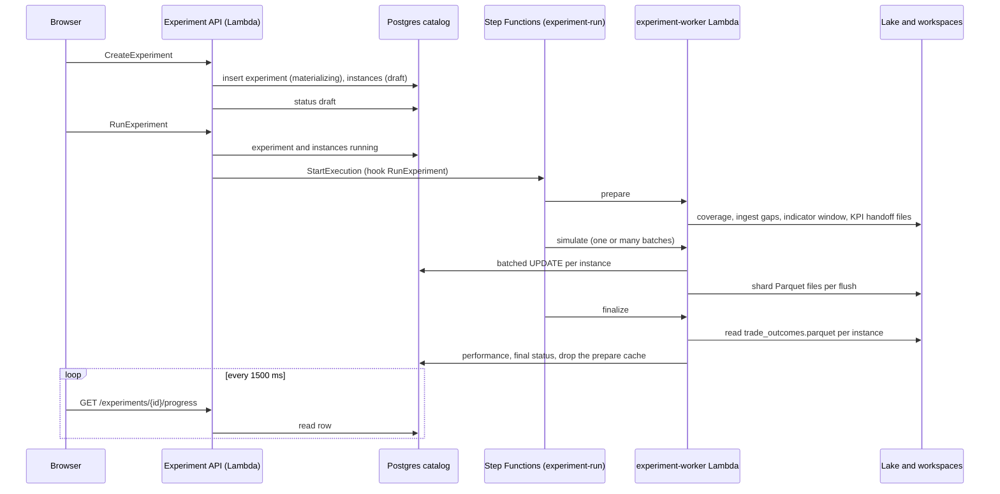
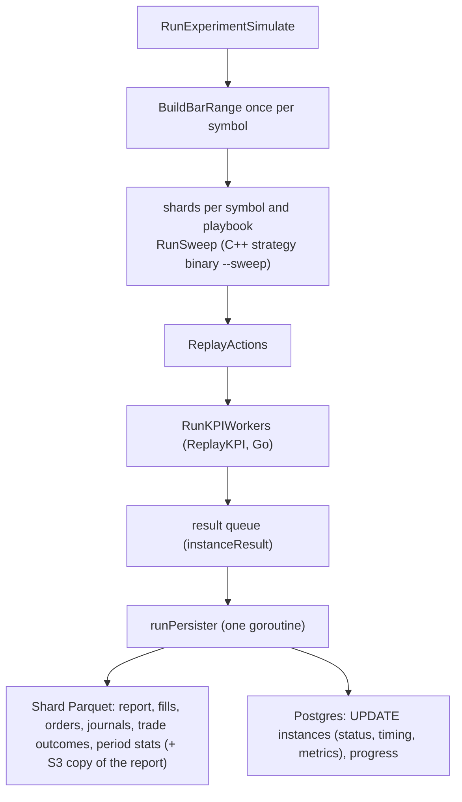
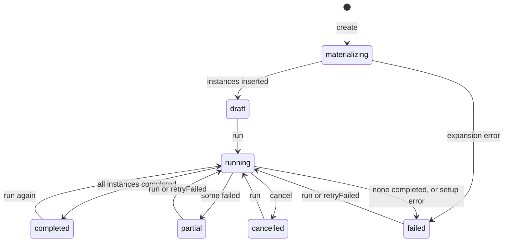
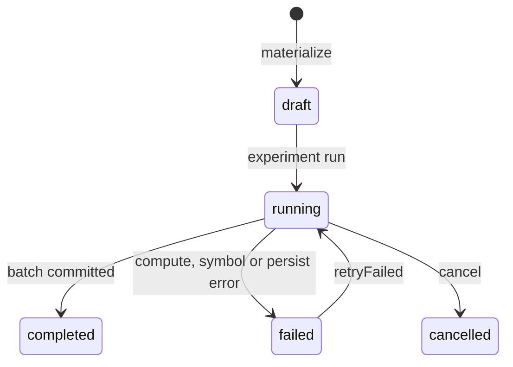

# Experiment and instance data flow

How an experiment goes from a click in the browser to fills, reports and rows in the database. Settings and tolerances are in [backtesting.md](backtesting.md).

- **Experiment**: one row with shared settings (range, capital, costs, provider) and N instances.
- **Instance**: one strategy config (playbook + `strategyConfig`) on one symbol. Its starting paper wallet is derived from the experiment settings and the instance symbol (`experimentWalletCoins`, simulate), not stored: it is identical for all instances of one symbol, so no per-instance file or object exists. Its results are row groups in a shard (`shard_key`, `experiments/<experiment_id>/shards/<shard_id>/` relative to `DATA_DIR`): one shard per persister flush, one Parquet file per datatype (`reports`, `fills`, `orders`, `journals`, `trade_outcomes`, `period_stats`), one row group per instance, located through the footer key `trading_copilot.instances` (instance id to row group index; an instance without rows of a type has no group) (`src/internal/instanceparquet`).

## The picture

The simulate phase, per instance:

## Lifecycle

Statuses are the strings in `src/backtest/store/store.go` and the SQL in `db/sqlc/queries/`.

Rules: `POST .../run` returns 409 while the experiment is `running`. `retryFailed` returns 400 when no instance failed, and re-simulates only `failed` instances (`EXPERIMENT_RETRY_FAILED=1` in the worker). An instance is `completed` only after its persistence batch committed.

## Stages

| Stage | Entry point | Inputs | Outputs / state | Failure and retry |
|---|---|---|---|---|
| Create | `CreateExperiment` -> `createStudy` (`src/experimentapi/create.go`) | settings + MANUAL list or GRID axes (`specsFromGrid`, max 20 000 valid combos) | `experiment` row `materializing`, then `experiment_instance` rows, status `draft` | up to 250 instances (`syncMaterialize`) in the request, more via `materializeAsync`; error -> experiment `failed` |
| Run request | `RunExperiment` (`handlers.go`) | experiment id, `retryFailed` | experiment and instances `running`; hook `RunExperiment` | `failed_precondition` if running; each run request starts its own execution; a failed start marks the experiment `failed` |
| Fan-out | `<prefix>-experiment-run` (`experiment_workflow.tf`, `experiment_fanout.tf`) | Prepare, then a Map over batches of `EXPERIMENT_BATCH_SIZE` instances (at most `experiment_map_max_concurrency` at once), then Finalize | `experiment-worker` Lambda (`src/cmd/experiment-worker`), one invocation per phase or batch | retry and catch per state (`experiment_worker_retry`, `experiment_worker_catch`); `JobStatus` reports a failed execution |
| Prepare | `RunExperimentPrepare` (`src/backtest/run_experiment_phases.go`) | settings, Parquet lake, ingest ledger (Postgres) | progress stages 1-3; KPI handoff files (`WriteAllExperimentSymKPI`, `WriteExperimentPrepareMeta`) | symbol without coverage: `ingestExperimentRange` then re-check; still failing -> `failSymbol` fails its instances; unavailable hours do not block |
| Simulate | `RunExperimentSimulate` | handoff files, instance ids | progress stage 4; instance results to the persister | per-instance error -> `failed` row; function only errors on setup |
| Persist | `runPersister` (`persist_pipeline.go`) | `instanceResult` queue | one shard per flush; Postgres status, timing, metrics, `shard_key` | shard write error fails every instance of the flush (the shard directory is removed); a failed instance has no `shard_key`; batch retried 3x (backoff), then bisected to single instances; last resort `failed` with `persist: ...` |
| Finalize | `RunExperimentFinalize` | instance statuses, `trade_outcomes.parquet` | `experiment_performance` (Postgres), final status, then the prepare cache (`.cache`) is removed | zero completed -> `failed`; any failed -> `partial`; else `completed`. Re-finalizing a finished experiment is not supported (the cache is gone); a new run re-prepares it |

The catalog is Postgres. The worker needs `DATABASE_URL` (`pgcatalog.Open`); without it the run fails (`experiment_catalog.go`).

Where state lives:

| State | Location |
|---|---|
| Experiment, instances, metrics, performance | Postgres (`db/sqlc/schema.sql`: `experiment`, `experiment_instance` with its aggregated metrics, `experiment_performance`, `experiment_period_stat`, `experiment_outcome_stat`). Postgres holds experiment metadata and aggregates, no rows of instance data. |
| Instance period stats (month and year buckets) | `period_stats.parquet` in the instance shard, next to the fill, order, journal and outcome files |
| Candles | `data/parquet/provider=.../` (read-only here), gaps in the `ingest_unavailable` table |
| Indicator window per symbol | `experiments/<experiment_id>/.cache` in the workspace store (`prepare_meta.json`, `instances.json`, `kpi/<symbol>.json`; handoff from prepare to simulate and finalize), removed at the end of finalize |
| Per instance | `data/experiments/<experiment_id>/instances/<instance_id>/`: paper wallet |
| Per flush | `experiments/<experiment_id>/shards/<shard_id>/` (workspace store): `reports`, `fills`, `orders`, `journals`, `trade_outcomes`, `period_stats` `.parquet`, one row group per instance |
| Running job (id, error, finished) | the Step Functions execution (`workflow.go`: `JobStatus` describes the latest one) |

Indicator bars (`parquet/ti/` in the lake) are the only persisted indicator output; an experiment never writes them except as a cache of a cold computation.

## One instance in detail

The experiment engine is C++ only. The strategy decides in C++; Go replays the decisions with the simulated fill model, so the numbers an experiment shows are the numbers the live simulation would produce for the same actions.

1. `BuildBarRange` (`src/calculation-technical-indicator/runner/bar_range.go`) once per symbol: aggregated bars, sub-candle closes, warm-up bars.
2. `cppSimulate` (`src/backtest/cpp_engine.go`) groups instances by symbol and playbook, cuts shards (see knobs), and per shard `BuildSweepRequest` then `RunSweep` runs `strategy-sma-cross` or `strategy-signal-consensus` with `--sweep` (protobuf `SweepRequest` in, run report out, `src/backtest/cpp_sweep.go`).
3. `ReplayActions` turns the reported sized actions into `ReplayAction`s. `RunKPIWorkers` -> `ReplayKPI` (`src/calculation-signal/runner/kpi_worker.go`) replays them against the bar closes with `execrunner.SimulateBarWithModel` (`src/internal/venue/sim`: spread, slippage and fee in bps against the bar close), rescales sizes by the replayed wallet equity over the C++ book equity, and builds the report with `BuildInstanceReportFromSim`. The orders, journals and fills it returns are the instance files. No disk or database access.
4. The same queue and persister as before. A run uses `VENUE_SIMULATE=1`; sizing comes from `allocate.PolicyFromEnv()` (`ALLOC_*`, copied from the experiment settings by `applyExperimentEnv`).

Parallel processes: the experiment's own setting (`parallelism`, optional, 0 or unset = auto) gives the number of concurrent C++ sweep processes; create validates it against the maximum, and the worker reads it from the experiment record at each run.

No fallback: an unsupported playbook or a missing binary fails the instance with the variable name; a crashed shard fails all its instances.

### Checks

`src/backtest/cpp_replay_test.go` runs the sweep and the replay over seeded lakes and checks the persisted shape: one journal and one fill order per fill, the same values in both, and period statistics that add up to the trade outcomes. The configs must fire vol_cut and pyramid (ma-cross) and close trades. Details in [backtesting.md](backtesting.md).

## Run on AWS (Step Functions)

The Experiment API does not start containers on AWS. `RunExperiment` writes the rows `running` and starts the state machine `<prefix>-experiment-run` with input `{experiment_id, retry_failed}` (execution name `<experiment_id>-<start ms>`, see `src/internal/experimentworkflow`). `CancelExperiment` stops the running executions of that experiment; `GetExperimentStatus` describes the latest one.

- `Prepare`: experiment-worker, phase `prepare`, returns `batches` (instance ids chunked by `EXPERIMENT_BATCH_SIZE`).
- `Simulate`: Map over `batches`, `MaxConcurrency` = `experiment_map_max_concurrency`; each item is one worker call with phase `simulate`.
- `Finalize`: phase `finalize`.
- Any Lambda service fault is retried (3 attempts); any other error goes to `MarkFailed` (phase `fail`, sets the experiment failed) and the execution ends `FAILED`.

Terraform: `infra/terraform/experiment_workflow.tf`, `experiment_fanout.tf` (definition). The worker image is `docker/experiment-worker/Dockerfile`.

## Progress and what the frontend polls

Base URL `VITE_EXPERIMENT_API_URL` (dev proxy in `src/frontend/vite.config.ts`). Service: `ExperimentService`, mounted in `src/experimentapi/api.go`.

| Method | Shows | Used by |
|---|---|---|
| `ListExperiments` | experiment list | list view |
| `GetExperiment` | summary only | detail header |
| `GetExperimentProgress` | status, stage (1 prepare, 2 market data, 3 indicators, 4 instance simulation), instance done/total, failed count | polled every 1500 ms while selected (`components/experiments-panel.tsx`), then the instance page reloads |
| `ListInstances` | paginated, SQL sort and filter on metric columns | instance table |
| `GetInstance` | one instance row | detail |
| `GetInstanceReport`, `GetInstanceKpis`, `GetInstanceActivity`, `GetChartSeries` (`fromSec`, `toSec`, `maxPoints`) | report, win-rate ladders, fills, chart data | instance detail |

Connect gzips a response when the client asks for it (`Accept-Encoding: gzip`). `maxPoints` on `GetChartSeries` buckets the candles to at most N (OHLC aggregated, indicators at the bucket's last candle); portfolio and markers stay exact. The frontend sends about two candles per viewport pixel (400 to 4000), and each zoom or range preset fetches its window with the same budget. See `src/experimentapi/README.md`.
| `GetExperimentPerformance` | experiment-level reduction | performance view |
| `GetExperimentStatus` | aggregate status (`status.go`) | not used by the SPA |
| `RunExperiment`, `CancelExperiment`, `DeleteExperiment` | actions | buttons |

## Knobs

| Variable | Default | Meaning |
|---|---|---|
| `DATABASE_URL` | unset | Postgres catalog, required by the worker (a run fails without it) and by the Experiment API Lambda |
| `EXPERIMENT_SIM_WORKERS` | CPU count | Go KPI replay workers (CPU bound) |
| `EXPERIMENT_CPP_PROCESSES` | CPU count | fallback for the concurrent C++ `--sweep` processes when the experiment has no "Parallel processes" value (see below) |
| `EXPERIMENT_MAX_PARALLELISM` | CPU count of the API process | the largest "Parallel processes" value create accepts; `GetExperimentLimits` returns it |
| `EXPERIMENT_CPP_SHARD_MAX` | 500 | upper bound of instances per shard (shard = `ceil(n/processes)` capped here) |
| `CPP_SMA_CROSS_BIN`, `CPP_SIGNAL_CONSENSUS_BIN` | set in the worker image (`/usr/local/bin/...`) | C++ strategy executables |
| `EXPERIMENT_BATCH_SIZE` | 64 | instances per simulate Map item (Terraform `experiment_batch_size`) |
| `EXPERIMENT_ARTIFACTS` | `fs` | `s3` also copies each instance report JSON to S3 |
| `EXPERIMENT_PHASE`, `EXPERIMENT_INSTANCE_IDS`, `EXPERIMENT_INSTANCE_FILE`, `EXPERIMENT_RETRY_FAILED` | set by the sandbox `cmd/backtest` run; the worker Lambda passes the phase in its payload | worker internals |

Persistence constants (not env): batch 200 results or 250 ms, queue `min(instances, 4096)`, report writers 8, 4 concurrent commits on Postgres, 3 retries (`persist_pipeline.go`).

## Known limits

- Experiments completed before the shard layout have no `shard_key` (and, before #164, no Parquet files at all). There is no fallback to the old per-instance files and no backfill: report, KPIs, activity and charts are empty for them (report and KPIs 404). Their activity and charts are empty and their trade outcomes are gone from `/kpis` and `/performance`. Re-running the experiment rebuilds them; re-finalizing without re-running does not (the prepare cache is removed at finalize). This is a deliberate behaviour change; no backfill exists.
- Fills are not written to Postgres any more, so large runs no longer pay for a fill COPY. The Parquet files of a 3000-instance run take 232 MiB (zigzag lake) and 484 MiB (random walk) and the run takes 14.9 s and 16.9 s (medians of three); see `docs/development/05-cpp-benchmark.md`.
- No single-flight: each run request starts its own Step Functions execution. Cancel stops the running executions of the experiment.
- The legacy single-backtest path (`backtest.Run`, `BACKTEST_ID`, `task backtest-run`) is a sandbox `docker run` only. The `POST /backtest/run` route went with the orchestrator, and this flow does not use it.
- The C++ engine supports only `ma-cross` and `signal-consensus`.
