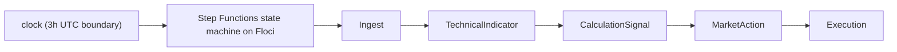
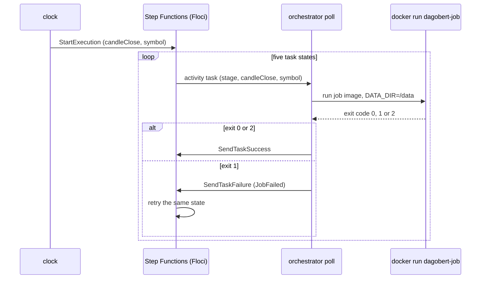

# Live pipeline data flow

What happens at each 3-hour UTC candle close. The experiment flow is in [experiment-data-flow.md](experiment-data-flow.md).

## The picture

The state machine (`definition` in `src/orchestrator/cmd/orchestrator/main.go`) has five Task states, all backed by one Step Functions activity. The orchestrator `serve()` registers the machine (`register`), starts `clock` (one execution per boundary, `nextBoundary`, named `close-<ms>-<nanos>`), and `poll`s the activity. `runJob` runs one job container at a time (global `jobMu`) and writes `live.json` (`writeLive`). `task run` starts one execution for `CANDLE_CLOSE_MS` (`runOnce`).

## Exit codes and retries

| Exit | Meaning | State machine |
|---|---|---|
| 0 | succeeded | next state |
| 2 | aborted, nothing to do | treated as success, next state |
| 1 or docker error | failed | `JobFailed` -> `Retry` `MaxAttempts: 2`, interval 2 s, backoff 2: two retries, three attempts in total, then the execution fails |

Every job logs `DETAIL=<n>`. Exit 2 is used for two different reasons: work already stored (`detail 1`) and upstream input not there or not closed yet (`detail 20`/`21`, for example an hour still open in ingest, no signal for market-action, no action for execution). A missing input therefore does not fail the execution; later states then also abort.

## Jobs

Entry points in `src/<job>/cmd/<job>/main.go`; the stage-to-args mapping is `runJobLocked` in the orchestrator. Paths are under `data/`.

| Stage | Reads | Writes | Exits 2 when |
|---|---|---|---|
| ingest (`ingest/internal/job/run.go`) | Binance klines (`BINANCE_BASE_URL`), `ingest.sqlite` | `parquet/provider=.../base=.../quote=.../year=.../candles.parquet`, `ingest.sqlite` (`stored`, `unavailable`) | hour still open, or nothing missing |
| calculation-technical-indicator | candle Parquet | `technical_indicator.sqlite` | bar already written, hour open or inputs missing |
| calculation-signal (`PLAYBOOK=ma-cross`) | `technical_indicator.sqlite` | `calculation_signal.sqlite` (signal) | duplicate signal or input not ready |
| calculation-market-action | signal, live Bybit balances | `calculation_signal.sqlite` (action) | action already stored, no signal |
| execution | action, Bybit demo host | `execution.sqlite` (order result, journal, balance) | order already stored (fill, rejection, no trade), pending order, no action |

Only market-action and execution receive Bybit credentials (`secretsEnvFile`: SSM, then `.secrets`, then env). Ingest starts from the hour after the newest stored open (`ingestFrom`), so one run also fills a gap.

## Idempotency and failure

- Re-running a close is a new execution. Each job checks its own store first and exits 2 on stored work, so only the first run places an order. The order is keyed by `orderLinkID(playbook, symbol, candleClose)` in `execution.sqlite`; a stored `fill`, `rejection` or `no-trade` returns 2, a `pending` order is polled instead of re-placed.
- A job that crashes mid-write is retried by the state machine; stores commit atomically, so the retry sees either nothing or the full result.
- After three failed attempts the execution is `FAILED` and nothing downstream runs; the next candle starts a fresh execution (ingest backfills the gap).
- Live stages run one at a time (`runJob` holds `jobMu` for the duration of a container).
