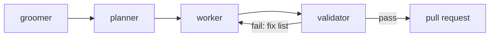

# Agent Harness

Agentic development splits work by model to keep token use down. A stronger model is used where judgement matters: grooming, planning and validating. A faster, cheaper model is the workhorse and does everything else. The main session orchestrates: it delegates, passes results on, and talks to the user. It does not do the work itself.

## Agents

| Agent | Model | Tools | Job |
|---|---|---|---|
| `groomer` | stronger model | no file edits | Gets issues to Ready: acceptance criteria, dependencies, size, splits ([01-task-management](01-task-management.md)) |
| `planner` | stronger model | read-only | Turns one issue into pull-request-sized slices and concrete work units; applies the applicability questions ([principles/02](principles/02-applicability.md)) first |
| `worker` | cheaper model | all but spawning agents | Implements one work unit, or does one chore: rebase, checks, board and PR bookkeeping, broad search |
| `validator` | stronger model | read-only, runs checks | Checks a change against plan, acceptance criteria and the [Definition of done](principles/README.md#definition-of-done); pass or fail |

## Flow

1. **Groom** the issue if it is not Ready yet.
2. **Plan** it. The plan holds every design decision, so the worker does not have to make any.
3. **Work**: one `worker` per work unit, each in the worktree of its pull request (see [01-task-management](01-task-management.md), Worktrees). Independent units can run in parallel.
4. **Validate** the result. On a failure, the fix list goes back to a `worker` as the next work unit.
5. Mechanical steps after that also go to a `worker`: push, open the pull request, update the board, rebase stacks.

Trivial changes (typos, a one-line fix) skip the harness.

## Why this split

- Most tokens go into reading files, running commands and writing code. A cheaper model does that well once the decisions are made.
- The stronger model only reads what it needs to judge, and returns a short result: a plan, a verdict or proposed issue text.
- The main session's context stays small, because subagents return summaries instead of file contents and logs.

The agents are defined in `tools/claude-plugin/agents/` and loaded with the plugin (see its README). Stronger-model agents run on `claude-opus-5-5`; workers run on `claude-haiku-5-5`.

Related: [01-task-management](01-task-management.md)
