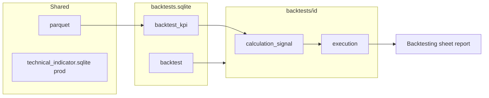

# Backtesting — product & engineering plan

## Goal

Add a **Backtesting** area where users define, run, and compare **multiple stored backtests** over historical data. A run produces a **report** with the same analytical surface as today’s **Strategy** page (activity, portfolio chart, KPI tags, decisions table), without overwriting live `./data` used by the stack and UI “live” strategy view.

This extends the ideas in `task seed-demo-year` into a first-class, repeatable workflow with configuration, persistence, and efficiency (reuse Parquet + optional indicator cache).

**Experiments (shipped):** multi-instance ma-cross experiments share one lake coverage gate, one in-memory KPI window, and persist `experiment_kpi` once at finalize. See `docs/architecture/backtesting.md`. Experiment-ready strategy listing (allowlist vs Go registry) is groomed in `docs/grooming/experiments-ready-strategies.md`.

---

## What exists today (baseline)

| Piece | Role |
|--------|------|
| `ingest` | Writes `parquet/provider={id}/base={B}/quote={Q}/year={YYYY}/candles.parquet` + provider-aware `ingest.sqlite` keys; skips already-stored hours |
| `calculation-technical-indicator` | Reads **Parquet**, aggregates to 3h bars, writes `technical_indicator.sqlite` (`kpi_revision`) |
| `calculation-signal` → `calculation-market-action` → `execution` | Per **candle close**: signal, sized action, simulated fill (`VENUE_SIMULATE=1`, `paper_venue.json`) |
| `seed-demo-year` | Wipes `data/`, ingest 1y, TI range backfill, ~3k in-process bar loop |
| Strategy UI | Activity from `calculation_signal.sqlite` + `execution.sqlite`; KPIs from fill replay + bar marks; portfolio chart |

**Gaps for backtesting:** no named runs, no settings UI, seed **destroys** live data, TI/signal DBs are **global** (one playbook overwrites “live” narrative), no fee/slippage model in simulation, report is not tied to a stored backtest id.

---

## Backtest settings (what to support)

Grouped by when they matter for implementation. **MVP** = minimum for a useful v1; **v2+** = research backlog.

### Universe & time

| Setting | MVP | Notes |
|---------|-----|--------|
| Symbol(s) | Single symbol | Multi-symbol portfolio backtest later |
| Date range (`from` / `to` UTC) | Yes | Align to 3h bar closes (same as pipeline) |
| Bar interval | Fixed 3h | Matches live stack; Parquet interval from ingest metadata |
| Playbook | Yes | Slug/path; same registry as live |

### Capital & sizing

| Setting | MVP | Notes |
|---------|-----|--------|
| Initial cash (quote) | Yes | Today: 50k USDC/USDT in seed `paper_venue.json` |
| Initial base position | Optional | Default 0 |
| Allocation policy | Inherit playbook/env | `ALLOC_TARGET_WEIGHT_PCT`, reserve, min order — snapshot per backtest |
| Leverage / margin | v2+ | Spot-only for MVP |

### Execution simulation

| Setting | MVP | Notes |
|---------|-----|--------|
| Fill price | Bar **close** (current sim) | Document as assumption |
| Spread | Yes | Full bid–ask width in bps; **half** applied per side vs bar close |
| Slippage | Yes | Extra adverse bps on top of half-spread (impact) |
| Fees | Yes | Taker bps on fill notional; deducted from quote; stored in `fill_journal` / `CumExecFee` |
| Partial fills | v2+ | Full fill at close today |
| Order latency | v2+ | Fill at T+1 bar |
| Rejections / min size | Yes (implicit) | Keep execution rules |

### Data & reproducibility

| Setting | MVP | Notes |
|---------|-----|--------|
| Data source | Shared lake | Read `DATA_DIR/parquet`; do not re-download if range covered |
| Indicator algo | `v1` | Same as `technical_indicator` job |
| Random seed | N/A until stochastic features | — |
| Label / description | Yes | User-facing name + notes |

### Report & benchmarks

| Setting | MVP | Notes |
|---------|-----|--------|
| KPI set | Same as Strategy | CAGR, max DD, Sharpe, vs B&H, Sortino, win rate (`strategy-kpi`) |
| Benchmark | Buy-and-hold same symbol | Already in KPI engine |
| Custom KPI window | v2+ | Sub-range on report |

All of the above are **editable in the backtest creation / edit UI** (drafts can be saved without running). Values are copied into `manifest.json` when the run starts so the report always reflects what was configured, not whatever changed in `.env` later.

### Creation UI — proposed defaults

Use these as pre-filled form values; user can change any field before save or run.

| Field | Control | Default | Notes |
|--------|---------|---------|--------|
| Name | text | `Backtest YYYY-MM-DD` (today) | Required |
| Description | textarea | empty | Optional notes |
| Symbol | select | `BTCUSDT` | From supported ingest list |
| Playbook | select | `ma-cross.yaml` | Same list as live deploy |
| From (UTC) | datetime | 1 year ago, snapped to hour | Clamped to available Parquet after first ingest |
| To (UTC) | datetime | last completed 3h close | Same snap rules as processing backfill |
| Initial USDC | number | `50000` | Quote wallet |
| Initial USDT | number | `50000` | Quote wallet (sim uses instrument quote) |
| Initial base (e.g. BTC) | number | `0` | Spot position before first bar |
| Target weight % | number | `10` | `ALLOC_TARGET_WEIGHT_PCT` |
| Cash reserve (quote) | number | `50` | Do not spend below this |
| Min order (quote) | number | `1` | Below → no-trade |
| Fill price | select | `Bar close` | Only option in MVP |
| Spread (bps) | number | `10` | Full bid–ask width (`SIM_SPREAD_BPS`; half per side vs close) |
| Slippage (bps) | number | `5` | Impact beyond spread (`SIM_SLIPPAGE_BPS`) |
| Fee (bps) | number | `10` | Taker fee on notional (`SIM_FEE_BPS`) |
| Re-download missing candles | checkbox | on | If off, fail when Parquet does not cover range |
| Indicator algo | select | `v1` | Read-only until multiple algos exist |

Advanced section (collapsed): workspace id (read-only after create), created at, last run status.

---

## Decisions (locked)

| Topic | Decision |
|--------|-----------|
| **Prod indicators** | Never write backtest TI into `technical_indicator.sqlite`. Live / Processing keep using prod TI only. |
| **Backtest indicators** | Single store: `data/backtests.sqlite` table `backtest_kpi` (name TBD) with **`backtest_id`** on every row. All backtests share this table; rows are keyed by `(backtest_id, symbol, bar_open, algo, …)`. |
| **Catalog** | Same file: `backtests` table (or equivalent) for id, name, status, settings JSON, workspace path, timestamps. |
| **Strategy page** | **Live only** — running strategies from prod `calculation_signal` + `execution`. No backtest selector. |
| **Run executor** | **Docker job** (`dagobert-backtest`), same pattern as ingest/execution. API sets status `running` and starts container; UI polls catalog. |
| **Performance SLO** | **&lt; 1 minute** for a typical 1y / ~3k-bar run when candles are already in Parquet (no network ingest). Optimize TI batch + in-process bar loop accordingly. |
| **Backtesting UI** | **`backtests.sqlite`-backed list** — repeater or table (like Strategy / Data pages). **Details in a side sheet** (create, edit settings, report) — not a separate full-page-only flow. |

---

## Storage model (multiple backtests)

**Principle:** Live job DBs unchanged; backtest catalog + TI in **`data/backtests.sqlite`**; per-run signal/execution still isolated on disk.

```text
data/
  parquet/provider=*/base=*/quote=*/year=*/     # shared Hive lake
  ingest.sqlite
  technical_indicator.sqlite       # prod / live only — backtests never write here
  calculation_signal.sqlite        # live strategy
  execution.sqlite                 # live execution
  backtests.sqlite                 # catalog + backtest_kpi (all backtest TI rows)
  backtests/
    <backtest-id>/
      paper_venue.json             # wallet snapshot for this run
      calculation_signal.sqlite    # signals + actions for this backtest only
      execution.sqlite             # fills / orders for this backtest only
      progress.json                # optional: bars_done, bars_total while running
```

### `backtests.sqlite` (sketch)

**`backtest`** — one row per stored backtest:

- `id` (UUID), `name`, `description`, `status`, `settings_json`, `workspace_rel_path`, `created_at`, `started_at`, `finished_at`, `error`, headline KPI cache optional

**`backtest_kpi`** — all indicator bars for all backtests (separate from prod `kpi_revision`):

- `backtest_id`, `symbol`, `bar_open`, `algo`, `body` (JSON OHLC + results), `origin`, `spec` — mirror prod shape where useful so TI job code can share insert/read paths with a `backtest_id` filter

Signal and execution jobs during a run use `DATA_DIR=.../backtests/<id>` and read KPI marks via **backtest TI API** (not prod sqlite).

**Status:** `draft` → `running` → `completed` | `failed`.

---

## Execution engine (extend seed, don’t fork logic)

### Pipeline (same order as live)

1. **Ensure candles** — Ingest only missing hours into shared Parquet when settings allow; skip network when range is covered.
2. **Ensure indicators** — Batch from Parquet into `backtest_kpi` for this `backtest_id` only (reuse `runRange`-style logic, new store adapter). Skip if rows already exist for `(backtest_id, symbol, range, algo)` on re-run.
3. **Bar loop** — In one container process: for each 3h close, `signal` → `market-action` → `execution` with workspace `DATA_DIR`, `BACKTEST_ID`, `VENUE_SIMULATE=1`, playbook from settings snapshot.
4. **Finalize** — KPIs into catalog or `report` fields; `status = completed`.

New Go package: `src/backtest/` + image `docker/backtest/Dockerfile` → `dagobert-backtest`:

- `Run(backtestID string) error` — entrypoint for job container.
- Extend TI store + `kpi.BarClose` (or parallel) to read **backtest_kpi** when `BACKTEST_ID` is set.
- Reuse runners; **never** write prod `technical_indicator.sqlite` during backtest.

### Efficiency (target &lt; 1 min with warm Parquet)

| Optimization | Benefit |
|----------------|---------|
| No Binance when Parquet covers range | Dominant win vs seed |
| Single batched TI pass into `backtest_kpi` | Same as `runRange`, no per-bar TI |
| In-process bar loop in one container | Already proven in seed |
| Re-run: skip TI insert if `backtest_kpi` complete for id+range | Idempotent re-run |
| Progress in `progress.json` or catalog | UI poll without parsing logs |

**Acceptance:** With `data/parquet/BTCUSDT.parquet` covering the backtest window, CI/system test asserts wall time **&lt; 60s** for full year ma-cross on a reference machine (document hardware in test).

---

## Frontend: Backtesting page

### Navigation

- Add **Backtesting** to `site-header` → `/backtesting`.

### Views (match Strategy / activity patterns)

1. **Main page** — **Repeater** (`<details>`) or **filterable table** of backtests from `backtests.sqlite`: name, symbol, range, playbook, status, duration, headline KPIs when completed.
2. **Side sheet** — Selecting a row or “New backtest” opens a **right-hand sheet** (same pattern as Strategy candle detail / wiki detail):
   - **Draft / edit:** full settings form (all fields adjustable; defaults from table above).
   - **Running:** progress (bars done / total) from catalog or `progress.json`.
   - **Completed:** report panel — reuse Strategy components (`ActivityView`, portfolio chart, KPI tags) via backtest-scoped APIs; read-only.
3. **Run** — Button in sheet → `POST /api/v1/backtests/[id]/run` → starts **Docker backtest job**; sheet stays open or user returns from list poll.

**Strategy page** is unchanged: live playbooks only.

### API (sketch)

| Route | Purpose |
|--------|---------|
| `GET /api/v1/backtests` | List catalog |
| `POST /api/v1/backtests` | Create draft |
| `PATCH /api/v1/backtests/[id]` | Update settings |
| `POST /api/v1/backtests/[id]/run` | Start run (async) |
| `GET /api/v1/backtests/[id]` | Manifest + status |
| `GET /api/v1/backtests/[id]/activity` | Same shape as `/api/v1/activity` |
| `GET /api/v1/backtests/[id]/kpis` | Same shape as `/api/v1/strategy/kpis` |

`resolveDataDir()` gains a branch: `BACKTEST_ID` or path from catalog.

### Shared analysis code

- `readActivity` / `strategy-kpi` accept **`backtestId`** (resolve workspace + `backtest_kpi` for marks).
- **Strategy** routes never pass `backtestId`.

---

## How runs are triggered

1. UI → `POST /api/v1/backtests/[id]/run` updates `status = running`.
2. API (or orchestrator helper) runs **`docker run`** / compose job: image `dagobert-backtest`, env `DATA_DIR=/data`, `BACKTEST_ID=<uuid>`, mount host `./data`.
3. Job exits 0 → `completed`; non-zero → `failed` + log snippet in `error`.
4. UI polls `GET /api/v1/backtests` or `GET /api/v1/backtests/[id]` every few seconds while `running`.

Local dev: `task backtest-run ID=…` wraps the same image for debugging without the UI.

---

## Testing & acceptance

- **System test:** small range (e.g. 7 days), assert fill count > 0, KPIs finite, workspace isolated from fixture live DB.
- **Regression:** `seed-demo-year` becomes thin wrapper: “create default backtest config + run” OR stays as demo reset with docs pointing to Backtesting for non-destructive runs.
- **Acceptance (MVP):**
  - User creates two backtests with different date ranges; both listed; reports differ.
  - Re-run after Parquet warm does not call Binance for covered range.
  - Live Strategy page unchanged after backtests.

---

## Phased delivery (stacked PRs)

Keep each PR reviewable (~400 lines). Suggested epic issues:

| # | Issue | Outcome |
|---|--------|---------|
| 1 | **`backtests.sqlite` + `backtest_kpi` schema** | Catalog table + TI table with `backtest_id`; workspace dirs |
| 2 | **TI writer/reader for backtest** | Batch from Parquet into `backtest_kpi`; `kpi.BarClose` backtest mode |
| 3 | **Backtest Docker job + runner** | `dagobert-backtest`; &lt;60s system test with warm Parquet |
| 4 | **Parquet coverage helper** | Ingest ensure-range; skip network when covered |
| 5 | **API: CRUD + run (docker) + status** | Next routes spawn job via socket helper |
| 6 | **UI: list + side sheet** | Repeater/table + create/edit/report in sheet |
| 7 | **Report APIs (Strategy parity)** | Activity, chart, KPIs by `backtestId` |
| 8 | **Fees & slippage in sim** | Settings + `placeOrderSimulated` |
| 9 | **Compare + export** | Optional |
| 10 | **Docs; seed vs backtest** | `seed-demo-year` docs point to Backtesting |

---

## Documentation to add when implementing

- `docs/architecture/backtesting.md` — runtime diagram, data layout, job entrypoints.
- `docs/development/run-backtest.md` — CLI/task usage.
- Update `docs/development/seed-demo-year.md` — relationship to backtesting.

---

## Architecture sketch



---

## Summary

Backtesting = **catalogued experiments** in `backtests.sqlite` (including **all TI rows keyed by `backtest_id`**), **prod TI untouched**, **Docker job** target **&lt;1 min** on warm Parquet, **Backtesting page** with **table/repeater + side sheet** for settings and Strategy-like reports. **Strategy** remains **live strategies only**.
